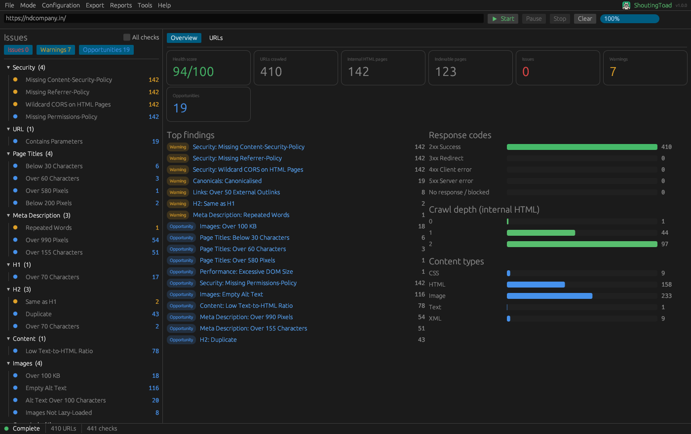

<p align="center">
  
</p>

<h1 align="center">ShoutingToad SEO Spider</h1>

<p align="center">
  The ShoutingToad SEO Spider is a website crawler that audits your site for over 300 SEO issues to help improve both SEO, and UX and more.<br>
  Free, open source and fast. Runs on Windows, macOS and Linux, as a desktop app or from the command line.
</p>

<p align="center">
  <a href="https://github.com/NDcompany/ShoutingToad/releases/latest"><b>Download</b></a> ·
  <a href="#features">Features</a> ·
  <a href="#command-line-and-ci">Command line &amp; CI</a> ·
  <a href="#what-it-checks">What it checks</a> ·
  <a href="#building-from-source">Build from source</a>
</p>

<p align="center"></p>

---

## Features

- **Fast, polite crawler.** Multi-threaded, with a configurable request delay. Respects robots.txt, reads XML, RSS, Atom and text sitemaps, handles gzip and Brotli, and follows redirects, canonicals, hreflang and pagination links.
- **441 checks across 27 categories.** Each finding comes with its type (Issue, Warning or Opportunity), a priority, what it means and how to fix it.
- **Site-wide analysis.** Finds duplicate and near-duplicate content, orphan pages, redirect chains and loops, broken internal and external links, hreflang return links, canonical chains, crawl depth and sitemap problems.
- **Health score and overview dashboard.** See what matters first, then click any issue to list every affected URL.
- **URL inspector.** Shows the details, issues, inlinks, outlinks, images, HTTP headers, a Google snippet preview (desktop and mobile) and the structured data of any URL.
- **List mode.** Audit just the URLs you paste in, without following links.
- **Community rule packs.** Add your own checks as simple TOML files, or use the Shopify, WordPress, Local SEO and E-commerce packs. See [Rule packs](#rule-packs).
- **Custom search and extraction.** Count or extract anything in the HTML with regular expressions.
- **Title and description writer.** Suggests new titles and meta descriptions for pages that need them, using your own API key for Anthropic Claude, OpenAI or any OpenAI-compatible server (Ollama, LM Studio, OpenRouter), or Google Gemini. With no key it falls back to offline rules. Keys are never saved to disk.
- **Internal link finder.** Finds pages that mention another page's topic without linking to it.
- **Reports and exports.** A self-contained HTML audit report you can print to PDF, plus CSV exports of every URL, issue, inlink, outlink, image and redirect chain.
- **Save and reopen crawls** as `.shoutingtoad` files.
- **Headless CLI** for scripts and CI pipelines, with exit codes for quality gates.
- **No account, no limits, no telemetry.** It only talks to the site you crawl and, if you choose, your AI provider.

## Install

Download the latest build for your system from the **[Releases page](https://github.com/NDcompany/ShoutingToad/releases/latest)**.

| System | File | How to install |
| --- | --- | --- |
| Windows 10/11 (64-bit) | `shouting-toad-x86_64-pc-windows-msvc.zip` | Unzip, then right-click `install_windows.ps1` → *Run with PowerShell*. This adds Start-menu and desktop shortcuts and puts `shouting-toad` on your PATH. Or just run `shouting-toad.exe` directly. |
| macOS (Apple Silicon) | `ShoutingToad-aarch64-apple-darwin.app.zip` | Unzip and drag **ShoutingToad.app** into Applications. The first time, right-click it and choose **Open**. |
| macOS (Intel) | `ShoutingToad-x86_64-apple-darwin.app.zip` | As above. |
| Linux (x86-64) | `shouting-toad-x86_64-unknown-linux-gnu.tar.gz` | Extract, then run `./install_linux.sh`. Run it as root to install for all users. |

On Linux you can also install straight from GitHub:

```bash
curl -fsSL https://raw.githubusercontent.com/NDcompany/ShoutingToad/main/installer/install_linux.sh | bash
```

## Using the app

1. Type a website address and press **Start**.
2. The **Overview** shows the health score, the top findings, response codes, crawl depth and content types while the crawl runs.
3. The **Issues** panel on the left lists everything found, grouped by category. Click an issue to list the affected URLs, with an explanation and how to fix it.
4. Click any URL to inspect it in the panel at the bottom.
5. Use **Reports → HTML audit report** for a shareable report, **Export** for CSVs, and **File → Save crawl** to keep the crawl.

**Configuration → Spider settings** controls the limits, threads, delay, user agent (including Googlebot presets), robots.txt handling, subdomains, external link checks, include/exclude patterns and custom search.

## Command line and CI

```text
shouting-toad crawl https://example.com --out report --max-urls 5000
shouting-toad list urls.txt --out report
shouting-toad checks            # every check as CSV
shouting-toad --help
```

Each run writes `report.html`, `issues.csv`, `issue_urls.csv`, `internal.csv`, `inlinks.csv`, `outlinks.csv`, `images.csv`, `redirects.csv` and `crawl.shoutingtoad` (which opens in the app).

Use `--fail-on high|medium|low` to exit with code 2 when the site has Issues at that priority or above, or `--fail-on-check <id>` to fail on specific checks. This makes ShoutingToad an SEO quality gate for deployments. **Reports → CI workflow** in the app generates a ready-made GitHub Actions workflow; the core of it is:

```yaml
- run: |
    curl -fsSL -o st.tar.gz https://github.com/NDcompany/ShoutingToad/releases/latest/download/shouting-toad-x86_64-unknown-linux-gnu.tar.gz
    tar -xzf st.tar.gz
    ./shouting-toad crawl "https://staging.example.com" --out seo-report --fail-on high
```

## Rule packs

Rule packs add checks written as small TOML files: CSS selectors, regexes on the HTML, URL, headers, status codes and page metrics, combined with `all`, `any` and `not`. Their findings appear everywhere the built-in checks do, including `--fail-on-check`.

```toml
[[rule]]
id = "old-shop-links"
name = "Links to the old shop"
kind = "issue"
priority = "high"
fix = "Link to /store/ instead."
when = { selector = 'a[href*="shop.example.com"]' }
```

```text
shouting-toad crawl https://example.com --rules rules/wordpress.toml
shouting-toad rules validate my-pack.toml
```

In the app: **Configuration → Rule packs…**. Starter packs for Shopify, WordPress, Local SEO and E-commerce are in [`rules/`](rules). The [rule pack guide](docs/rule-packs.md) covers the full format, testing and sharing; publish your own pack with the GitHub topic `shoutingtoad-rules`.

## What it checks

| Category | Checks | Examples |
| --- | ---: | --- |
| Response Codes | 56 | 4xx and 5xx errors by code, timeouts, TLS errors, URLs blocked by robots.txt |
| Redirects | 13 | Chains, loops, redirects to errors, HTTPS→HTTP, meta refresh, JavaScript redirects |
| Security | 25 | HTTP pages, mixed content, HSTS, CSP, cookie flags, unsafe cross-origin links |
| URL | 19 | Uppercase, parameters, session IDs, tracking parameters, duplicates via case or trailing slash |
| Page Titles | 17 | Missing, duplicate, too long in characters or pixels, same as H1, placeholder text |
| Meta Description | 14 | Missing, duplicate, length, pixel width, outside `<head>` |
| Meta Keywords | 3 | Present, multiple, duplicate |
| H1 / H2 / Headings | 16 | Missing, duplicate, multiple, empty, skipped levels |
| Content | 10 | Thin content, exact and near duplicates, soft 404s, readability, lorem ipsum |
| Images | 17 | Missing alt text, broken, oversized, missing dimensions (CLS), legacy formats |
| Canonicals | 18 | Missing, conflicting, pointing at redirects, errors, noindex pages or chains |
| Pagination | 6 | Broken or non-indexable rel=next/prev, loops |
| Directives | 17 | noindex, nofollow, X-Robots-Tag, snippet limits, conflicting directives |
| Robots.txt | 11 | Missing, server errors, blocking the whole site, syntax errors |
| Sitemaps | 18 | Missing, invalid, oversized, redirects, errors, noindex URLs, orphan pages |
| Hreflang | 13 | Missing return links, invalid codes, missing x-default, non-canonical targets |
| Structured Data | 69 | JSON-LD errors and the required and recommended properties for Google rich results |
| Social | 13 | Open Graph and Twitter card tags |
| Links | 22 | Broken internal and external links, redirects, nofollow, broken #bookmarks, crawl depth |
| Resources | 11 | Broken CSS and JavaScript, content that needs JavaScript to render, third-party scripts |
| Performance | 18 | Slow responses, compression, HTTP/2, caching, render-blocking scripts, DOM size, page weight |
| Mobile | 7 | Viewport, zoom disabled, plugins, icons |
| Accessibility | 13 | Language, link and button names, form labels, captions, landmarks |
| Validation | 12 | Doctype, invalid `<head>` elements, character encoding |
| AMP | 3 | Broken or invalid AMP links |

Run `shouting-toad checks`, or open **Help → All checks** in the app, to see every check with its explanation and fix.

## Building from source

You need the stable [Rust toolchain](https://rustup.rs) (1.87 or newer).

```bash
git clone https://github.com/NDcompany/ShoutingToad.git
cd ShoutingToad
cargo build --release      # binary in target/release/
cargo test                 # unit and end-to-end tests
```

On Linux, install the windowing libraries first: `sudo apt install libxcb-render0-dev libxcb-shape0-dev libxcb-xfixes0-dev libxkbcommon-dev libgl1-mesa-dev`.

## Contributing

Bug reports and pull requests are welcome. Please open an [issue](https://github.com/NDcompany/ShoutingToad/issues) describing the problem, with the URL or a small HTML sample if a check misbehaves. Run `cargo fmt`, `cargo clippy --all-targets` and `cargo test` before sending a pull request.

## License

ShoutingToad is free software: you can redistribute it and modify it under the terms of the [GNU Affero General Public License v3.0](LICENSE) or (at your option) any later version.

Made by [N&D Co.](https://ndcompany.in)
